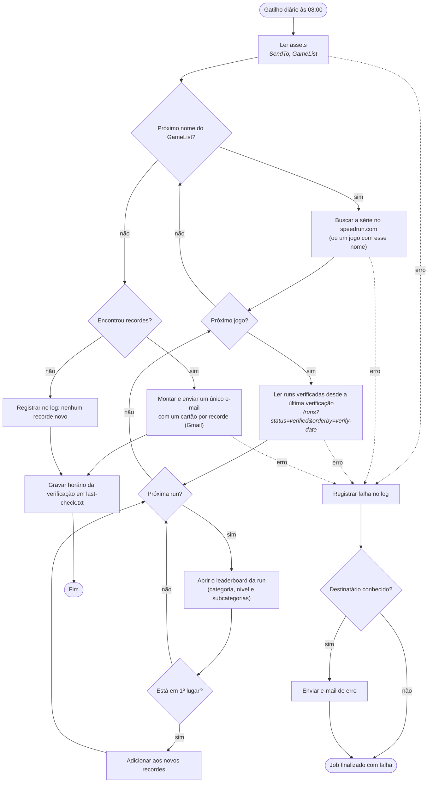

# Fluxo do processo – Speedrun Record Checker

Este documento descreve, passo a passo, o que o robô faz em cada execução. Todo o processo fica no
[`Main.xaml`](Main.xaml).

## Visão geral

O gatilho do Orchestrator inicia o robô todos os dias às 08:00 (Brasília). O robô consulta a API do
speedrun.com, encontra as runs verificadas desde a última verificação que estão em 1º lugar no leaderboard
e envia um único e-mail com os novos recordes mundiais.

## Diagrama

## Etapas

| # | Etapa | Atividade no `Main.xaml` | O que faz |
|---|-------|--------------------------|-----------|
| 1 | Ler configurações | *Get Asset – SendTo / GameList* | Lê os dois assets da pasta `SpeedrunRecordChecker` do Orchestrator. |
| 2 | Buscar jogos | *Buscar novos recordes mundiais (API speedrun.com)* | Para cada nome do `GameList`, procura a série e pega todos os jogos dela. Sem série com esse nome, procura um jogo. |
| 3 | Runs novas | *Buscar novos recordes mundiais* | Lê as runs verificadas desde o horário de `last-check.txt`. Na primeira execução, olha as últimas 24 horas. |
| 4 | Filtrar recordes | *Buscar novos recordes mundiais* | Abre o leaderboard de cada run (mesma categoria, nível e subcategorias) e fica só com as que estão em 1º lugar. Entram jogo completo e níveis individuais. |
| 5 | E-mail | *Send Email – Novos recordes* | Envia um único e-mail pelo Gmail com um cartão por recorde: jogo, categoria, tempo, jogador, datas, vídeo, página da run e leaderboard. |
| 6 | Gravar estado | *Salvar horário da última verificação* | Grava em `last-check.txt` o horário (UTC) em que a verificação começou. |

## Entradas

**Assets do Orchestrator** (pasta `SpeedrunRecordChecker`):

| Asset | Exemplo | Uso |
|---|---|---|
| `SendTo` | `voce@exemplo.com` | Destinatário dos e-mails de recordes e de erro |
| `GameList` | `Resident Evil, Dino Crisis` | Séries (ou jogos) separados por vírgula, ponto e vírgula ou quebra de linha |

**Arquivo de estado**: `%LOCALAPPDATA%\SpeedrunRecordChecker\last-check.txt` (última verificação
concluída).

## Saídas

- **E-mail de recordes**, só quando há recordes novos. Assunto:
  - 1 recorde: `Novo recorde mundial <jogo> – <categoria>`;
  - mais de um: `Novos recordes mundiais: <jogo> – <categoria>; <jogo> – <categoria>`;
  - acima de 150 caracteres: `Muitos novos recordes mundiais (N)`.
- **E-mail de erro**, quando a verificação falha.

## Regras de exceção

| Situação | O que acontece |
|----------|----------------|
| Limite de requisições do speedrun.com (420/429) ou erro 5xx | Pausa entre chamadas e tenta de novo até 4 vezes, esperando mais a cada tentativa. |
| Qualquer outra falha na verificação ou no envio | E-mail de erro para `SendTo` e job **com falha**. O `last-check.txt` não muda, então a execução do dia seguinte cobre o período perdido. |
| O próprio `SendTo` não pôde ser lido | A falha fica só no log, porque não há para quem enviar o e-mail de erro. |
| Computador desligado às 08:00 | O job fica pendente no Orchestrator até o robô ficar disponível. A execução seguinte cobre todo o período desde a última verificação concluída. |

## Sistemas envolvidos

- **speedrun.com** (API REST v1): séries, jogos, runs e leaderboards
- **Gmail** (UiPath Integration Service): envio dos e-mails
- **UiPath Orchestrator**: assets, gatilho diário e robô não assistido
